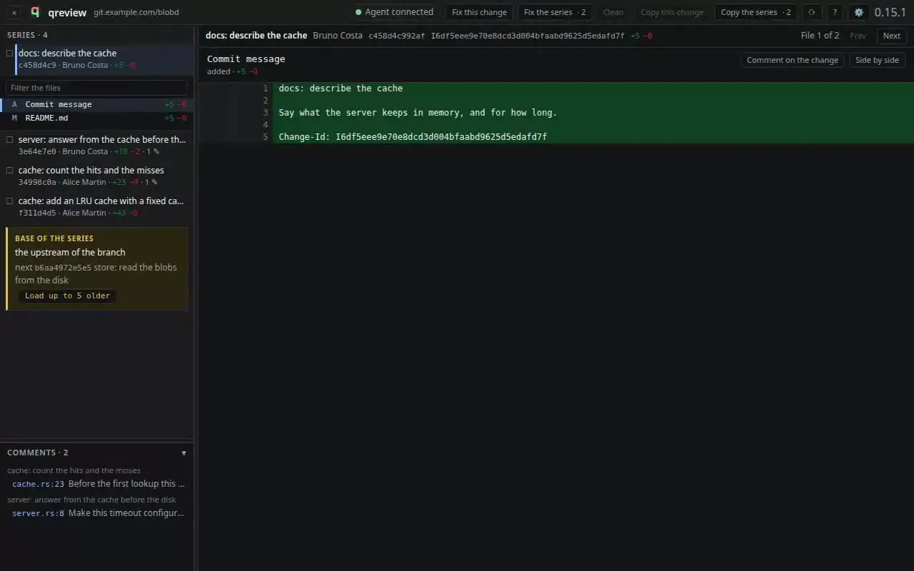

#  qreview

Local code review for a Git series, in your browser, with the Gerrit model:
one change at a time, with patch sets.

One binary, no runtime to install, nothing leaves your machine.



## Install

One link, always the newest build:

```sh
curl -fLO https://github.com/Intersec/qreview/releases/latest/download/qreview-linux-x86_64.gz
gzip -d qreview-linux-x86_64.gz
install -m 755 qreview-linux-x86_64 ~/.local/bin/qreview
qreview --version
```

Make sure `~/.local/bin` is on your PATH. The binary is static: it needs
`git` on the PATH and nothing else. Every version, with its notes, is on the
[releases page](https://github.com/Intersec/qreview/releases).

To build it yourself instead, see [Build from source](#build-from-source).

## Why

Local diff viewers copy the GitHub model: one branch, one flat diff. A Gerrit
workflow needs two other things. The commit is the review unit, so a series of
eight commits is eight reviews. The patch set is the second axis, because the
question is often "what changed since the last version of this change".

qreview reads the local repository, starts a small web server on the loopback
address, and opens the browser.

## Use

```sh
qreview                                          # the current series
qreview af448g1                                  # one commit
qreview af448g1..HEAD                            # a range
qreview af448g1 --prev 4888eaa8 --prev 774faaa9  # with older patch sets
qreview export                                   # the comments, as Markdown
qreview list                                     # what this repository holds
```

| Option | What it does |
|---|---|
| `--base <rev>` | Set the base of the series. It wins over every rule |
| `--prev <sha>` | Treat a commit as an older patch set. Repeatable |
| `--no-gerrit` | Skip the Gerrit query |
| `--no-worktree` | Leave out the changes that are not committed |
| `--no-open` | Print the URL, open no browser |
| `--port <n>` | Use a fixed port |
| `-v, --verbose` | Print the series and the files of every change |
| `--trace` | Print on standard error what every piece of work costs |

What the browser shows:

- The series on the left, one line per commit. qreview walks back through the
  history and stops on its own. The card at the end of the list says what
  stopped it: a merge, a tag, or the base of your branch. It names the next
  commit too, and **Load up to 5 older** goes further back. What you have
  changed and not committed stands above the newest commit, as one more
  change.
- The files of the change, then the diff, unified or side by side, with the
  changed words marked inside a line.
- Comments on a line, on a range of lines, on a part of a line, on a file,
  or on the change. Markdown in the body. Select the code with the mouse, or
  press `v` and grow the range with `j` and `k`.
- A patch set selector, and a diff between any two versions.
- A merge read against the auto-merge, so you see the conflict resolution and
  not the whole branch it brought in.
- A **⟳** button that reads the repository again, so an amend or a new
  commit made while the page is open joins the series without a restart.
- Two buttons that put the review in the clipboard, made to be pasted into a
  session with an AI agent.

The keys are the ones Gerrit uses, so a reader who lives in Gerrit needs no
second set of habits. `?` lists them in the interface.

| Key | What it does |
|---|---|
| `j` / `k` | The next or the previous line |
| `n` / `p` | The next or the previous hunk |
| `]` / `[` | The next or the previous file |
| `J` / `K` | The next or the previous change |
| `v` | Start a range on this line. `j` and `k` grow it |
| `c` | Write on the line, on the range, or on what the mouse selected |
| `u` | Show or hide the series |
| `/` | Filter the files |
| `,` | Preferences |
| `?` | The list of keys |

Comments are stored under `~/.local/state/qreview`, keyed by `Change-Id`. An
amend keeps them.

## Review with an agent

An agent that works on the series in a terminal, such as Claude Code, can
take part in the review. For Claude Code, install the skill in
[`skills/qreview`](skills/qreview/SKILL.md):

```sh
mkdir -p ~/.claude/skills
cp -r skills/qreview ~/.claude/skills/
```

The skill holds no procedure of its own. It runs `qreview skill`, which
prints the procedure of the binary on your PATH, so the skill and the binary
are always the same release. A new release of qreview needs no new copy of
the skill.

A plugin marketplace can serve the same skill from this repository. The
file of the skill changes only when the way to read the procedure changes,
so the entry pins a version of its own:

```json
{
  "name": "qreview",
  "version": "1.0.0",
  "source": { "source": "github", "repo": "Intersec/qreview" }
}
```

Then ask Claude to open qreview and answer your remarks.

The agent starts `qreview` itself, and the review opens in your browser. If
a server already runs on the repository, `qreview` prints its address and
opens no second tab.

The agent writes through these commands. Each one finds the server of the
repository on its own:

```sh
qreview comment src/net.c:new:42 --body "The result of read is not checked."
qreview reply c-5b72… --body "Renamed." --done
qreview reply c-5b72… --body "Log it, or return it?" --blocked
qreview wait                  # block until you ask, print the thread as JSON
qreview export --json         # the open threads, each comment with its id
qreview migrate --from 4a91… --done c-5b72…  # after an amend, see below
qreview refresh               # read the repository again
```

The agent answers when you ask it, one thread at a time: **Ask agent** on a
thread, or **Save and ask** in a comment box. **Ctrl+Shift+Enter** does
both: in a box it saves and asks, and on a line it asks about the thread
there. Until then, write, change and delete remarks as you like: nothing
reaches the agent.

In the browser, a remark opens a thread. Reply under it, and check **Done**
when the work is done. A done thread is grey and folded, and a click opens
it. A remark of the agent is blue. When the agent asks a question with
`--blocked`, the thread gets a red edge, its change and its file get a mark,
and the tab title starts with the number of open questions. Your next reply
answers it.

A done thread leaves every count and the export, so the agent does not get
the same work twice.

**After an amend**, the agent runs `qreview migrate --from <old sha>`. It
tells qreview that the new commit replaces the old one, and every thread
moves to its line in the new version, open or done. The old commit stays
readable as an earlier patch set, with each thread where it stood, as it
stood, and a link to where it went. This needs no `Change-Id`.

**Fix this change** (or `a`) asks the agent to deal with the open threads
of the change on the screen. **Fix the series** (or `A`) asks the same for
every change of the series. A dialog lists the threads, and `Enter` sends.
If the agent waits for an answer, the dialog lists those questions instead
and sends nothing. The buttons are greyed out while no agent runs
`qreview wait`.

While the agent works on a fix, the page says **Agent working…** and holds
its writes, then shows the whole fix at once when the agent waits again. A
remark you are typing meanwhile stays in its box, and follows its line to
the new version.

When a fix ends, or the agent answers, while you look at another window,
the browser notifies you. It asks for leave the first time you press Fix
or Ask. The tab title says whose turn it is too: ⏳ while the agent works,
then a turning ◑ once it is done, until you come back to the tab, or
until you answer when the agent asked you something.

**Clean** deletes the done threads of the change, once you agree with the
work. It lists them and asks first, then waits three seconds with an
**Undo**.

If Claude Code runs commands in a sandbox, start `qreview` yourself, in
your own terminal, and let the agent connect to it. A server started from
inside the sandbox cannot save comments, and your browser cannot reach it.
The agent commands reach your server through its Unix socket under `/tmp`,
which the sandbox shares with your machine: nothing to configure.

## Build from source

Rust and Node, both pinned in `.tool-versions` for
[mise](https://mise.jdx.dev) or asdf. Node builds the interface. It is not
needed to run the tool.

```sh
git clone https://github.com/Intersec/qreview.git
cd qreview
make setup         # the interface dependencies, once
make build         # the interface, then the binary
make check         # the gate: lint, format, tests, build
make install       # into ~/.local/bin
make dist          # the release file, under dist/
```

`make dist` adds the `x86_64-unknown-linux-musl` target when it is missing. It
needs no C toolchain: Rust links musl with its own bundled linker.

## Gerrit

When the repository has a Gerrit remote, qreview lists the patch sets already
pushed and can diff the local commit against them. It reads the host, the
port, and the project from the remote URL, and the target branch from
`.gerrit-branch` when the file exists.

qreview only reads. It never votes, never comments on the server, and never
pushes.

## Custom file types

Bundled grammars claim the common extensions on their own. A code base with
its own file types declares them once, in `.qreview.json` at its top level, so
every reader of that repository gets the map with no setup:

```json
{ "languages": { "blk": "c", "pxc": "c", "pyx": "cython" } }
```

A grammar is data too. Drop a `.sublime-syntax` or `.tmLanguage` file in
`~/.config/qreview/grammars/` and name it in the map. No rebuild.

qreview says when a newer release is out, beside the version it runs. It asks
the releases page of the project once per run, after the diff is on the
screen.

Personal settings go in `~/.config/qreview/config.json`. The preferences
panel behind `,` writes that same file, so the next run starts the way you
left it. See `examples/config.json`.

## Documentation

| Document | What it holds |
|---|---|
| [`roadmap/concept.md`](./roadmap/concept.md) | The problem, the users, the non-goals, the prior art |
| [`roadmap/design.md`](./roadmap/design.md) | The architecture, the data model, the API |
| [`roadmap/stack.md`](./roadmap/stack.md) | The technology decisions, with a date each |
| [`examples/`](./examples/) | Configuration files to copy |
| [`roadmap/testing.md`](./roadmap/testing.md) | The test policy |
| [`CONTRIBUTING.md`](./CONTRIBUTING.md) | The branch model, the commits, the release |

## License

Apache-2.0. See [`LICENSE`](./LICENSE).
